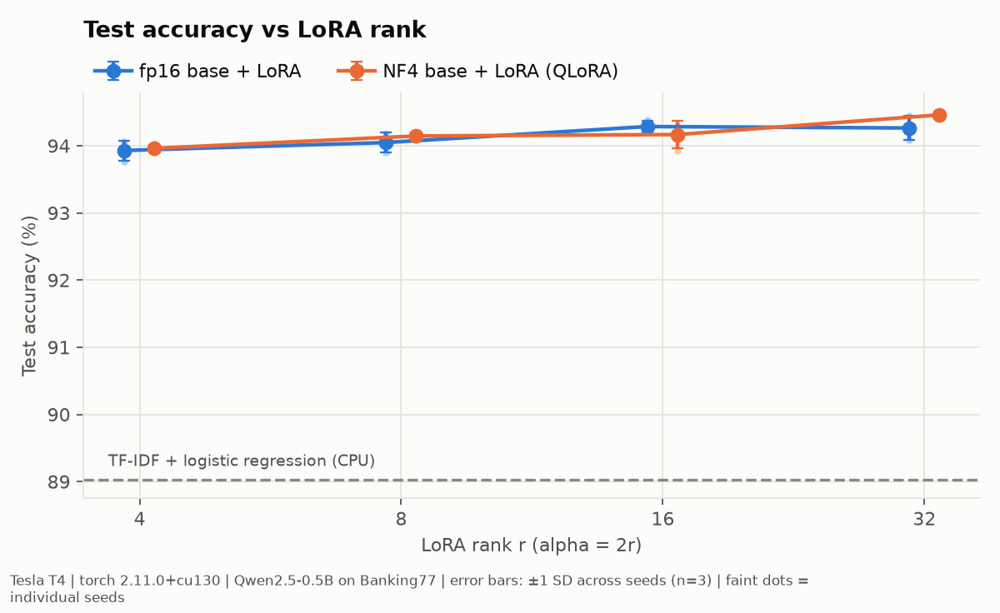
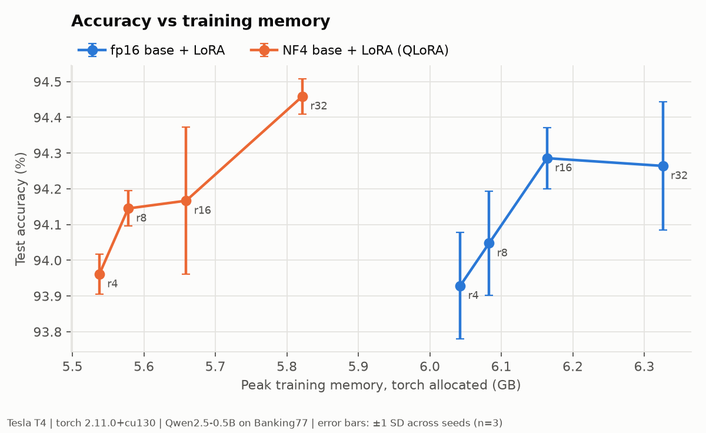
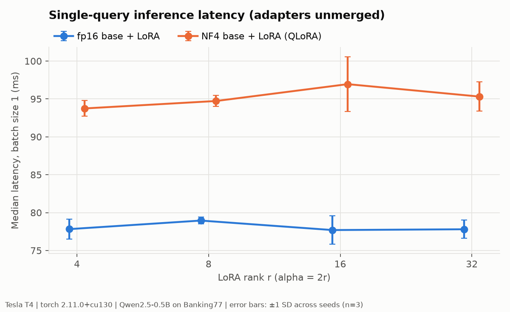
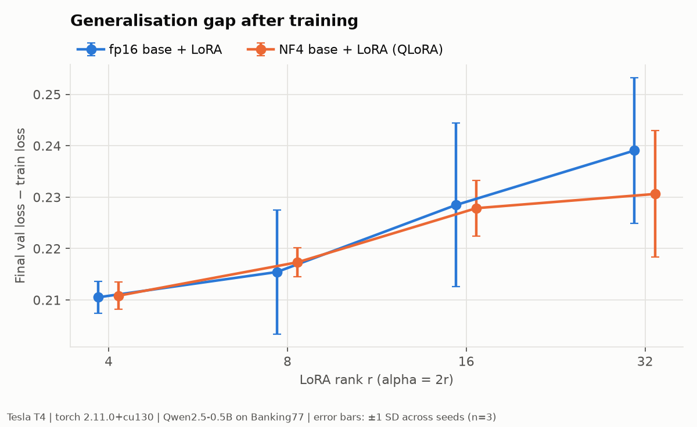

# How much LoRA do you need on one T4? A seed-controlled rank × precision ablation

**Question.** For routing customer-support messages into 77 banking intents, which LoRA rank (4, 8, 16, 32) and which base-model precision (fp16 vs 4-bit NF4, i.e. QLoRA) gives the best held-out accuracy for Qwen2.5-0.5B, and what does each choice cost in GPU memory, training time and inference latency?
**Budget.** One NVIDIA T4 (free-tier Google Colab): 24 runs (2 precisions × 4 ranks × 3 seeds) at fixed hyperparameters, completed in 2.1 hours of wall-clock time.
**Decision it supports.** Which adapter configuration a small team without a GPU cluster should pick for an intent classifier, and whether it beats a CPU-only baseline by enough to justify a GPU at all.

**Headline (bounded).**
- **Adapter vs CPU baseline.** On this task and budget, a rank-4 LoRA adapter on an fp16 base reached **93.9 ± 0.2 % test accuracy** (mean ± SD, 3 seeds). That is **4.9 pp above a CPU TF-IDF baseline** (paired 95 % CI 3.9 to 5.9 pp).
- **Higher rank.** Raising the rank to 32 added at most 0.5 pp, which is not reliably distinguishable from noise at this test-set size.
- **4-bit base.** Switching to a 4-bit (NF4) base changed accuracy by no detectable amount and saved only 0.5 GB of peak training memory (8 %), but it added about 16 ms (+21 %) to single-query latency.
- **Scope.** These conclusions are specific to a 0.5B model, 9k training examples and one untuned learning rate (§6).

**Walkthrough video (6 min):** *link to be added*



---

## Contents
1. [Reproduce it](#1-reproduce-it)
2. [Repository layout](#2-repository-layout)
3. [Evaluation protocol](#3-evaluation-protocol)
4. [Results](#4-results)
5. [What this does and does not show](#5-what-this-does-and-does-not-show)
6. [Limitations and threats to validity](#6-limitations-and-threats-to-validity)
7. [Model and data documentation (audit view)](#7-model-and-data-documentation-audit-view)
8. [EU AI Act Annex IV mapping](#8-eu-ai-act-annex-iv-mapping)
9. [Why this matters here](#9-why-this-matters-here)
10. [Skills demonstrated](#10-skills-demonstrated)
11. [What more compute would buy](#11-what-more-compute-would-buy)

---

## 1. Reproduce it

**Figures, table and audit only (any machine, no GPU, a few minutes).** Everything in §4 is rendered from the committed raw measurements in `results/`:

```bash
git clone <this-repo-url> && cd <repo>
pip install -r requirements.txt   # Python 3.11-3.13
pip uninstall -y torchao          # only needed if torchao < 0.16 is present (Colab ships 0.10)
python scripts/audit.py           # overlap, slices, paired bootstrap  -> results/audit/
python scripts/make_figures.py    # figures/*.png and results/summary.md
```

Running these two scripts on a Windows laptop reproduced the Colab-generated `summary.csv`, `slices.csv`, `per_class.csv` and `test_overlap.csv` byte for byte.

**Full re-run (one GPU, about 2 hours on a T4).** Open `run_on_colab.ipynb` in Colab with a T4 runtime and run the cells top to bottom. The notebook only calls the scripts below, so the same commands work on any CUDA machine:

```bash
python scripts/env_info.py       --results-dir results_rerun   # hardware + pip freeze
python scripts/baseline_tfidf.py --results-dir results_rerun   # CPU baseline, ~1 min
python scripts/run_ablation.py   --results-dir results_rerun   # 24 runs, resumable
python scripts/audit.py          --results-dir results_rerun
python scripts/make_figures.py   --results-dir results_rerun --figures-dir results_rerun/figures
```

`run_ablation.py --smoke --seed 0 --rank 8` checks the whole pipeline on a 256-example subset in about two minutes. The dataset is downloaded from a pinned commit and checked against a SHA-256 hash; the model is loaded at a pinned Hugging Face revision. Nothing depends on files outside the repository.

## 2. Repository layout

| Path | Purpose |
|---|---|
| `configs/ablation.json` | Single source of truth: model/data pins, hyperparameters, grid |
| `scripts/data.py` | Download, hash check, fixed stratified train/val split |
| `scripts/train_eval.py` | One configuration: train, evaluate, time, measure memory, append one row |
| `scripts/run_ablation.py` | The grid, one fresh process per run (clean peak-memory readings), resumable |
| `scripts/baseline_tfidf.py` | TF-IDF + logistic regression reference on the same split |
| `scripts/audit.py` | Train/test overlap, clean-subset accuracy, length and per-intent slices, paired bootstrap between configurations |
| `scripts/make_figures.py` | All figures and `results/summary.md` from the raw CSV |
| `scripts/env_info.py` | Hardware/software capture |
| `results/runs.csv` | **Raw measurements**, one row per run, including hardware and library versions |
| `results/predictions/`, `results/curves/` | Per-run test predictions and per-epoch training curves |
| `results/audit/` | `test_overlap.csv`, `slices.csv`, `per_class.csv`, `paired_differences.csv`, `summary.json` |
| `results/environment.json`, `results/pip_freeze.txt` | Reference-session environment |
| `figures/` | Rendered from `results/` only |
| `run_on_colab.ipynb` | Thin notebook that calls the scripts |

## 3. Evaluation protocol

| Item | Setting |
|---|---|
| Base model | `Qwen/Qwen2.5-0.5B` at revision `060db6499f32faf8b98477b0a26969ef7d8b9987` (Apache-2.0), with a 77-way linear classification head on the last non-padding token |
| Data | Banking77 ([Casanueva et al., 2020](https://arxiv.org/abs/2003.04807)), CC-BY-4.0, from commit `57ec275` of `PolyAI-LDN/task-specific-datasets`; SHA-256 recorded in `configs/ablation.json` |
| Split | Official train file (10,003) split once, stratified, `split_seed=1234`: 9,002 train / 1,001 validation. Official test file (3,080) used only for final reporting. Same split for every run. |
| Grid | Base precision {fp16, NF4 with double quantisation} × LoRA rank {4, 8, 16, 32} × seed {0, 1, 2} = 24 runs |
| LoRA | All attention and MLP projections (`q,k,v,o,gate,up,down`), alpha = 2r (constant scaling across ranks), dropout 0.05; classification head fully trained and zero-initialised. Adapter and head weights kept in fp32 in both arms, so the arms differ only in how the frozen base is stored. |
| Optimisation | AdamW, lr 2e-4, no weight decay, 6 % linear warm-up then linear decay, 3 epochs, batch 32, grad-norm clip 1.0, fp16 autocast with dynamic loss scaling (T4 has no bf16). Max length 128 tokens (no input was truncated). |
| What the seed controls | LoRA A-matrix initialisation, dropout masks, data order. **Not** the data split. |
| Accuracy | Test accuracy and macro-F1 on all 3,080 test items, after the final epoch (no checkpoint selection on test) |
| Memory | `torch.cuda.max_memory_allocated` during training, reset after model load; `max_memory_reserved` also logged. Excludes the CUDA context. |
| Time | Wall-clock of training steps only (validation passes excluded), `torch.cuda.synchronize()` at boundaries |
| Latency | Batch size 1, 20 warm-up then 200 timed test queries, p50 and p95; adapters **unmerged**. Throughput: full test set at batch 64. |
| Compute estimate | ≈ 4 × (non-embedding params) × (training tokens): 2 FLOPs/param/token forward plus 2 for activation gradients; frozen weights get no weight-gradient pass |
| Uncertainty | Seed spread: mean ± 1 sample SD over 3 seeds. Differences between configurations: paired bootstrap over the 3,080 test items (10,000 resamples, per-item correctness averaged over seeds), 95 % percentile CI |

## 4. Results

| Base precision | Rank | Seeds | Test acc (%) | Macro-F1 (%) | Trainable params (M) | Peak train mem (GB) | Train time (min) | Batch-1 latency p50 / p95 (ms) | Throughput, batch 64 (ex/s) | Est. train compute (TFLOP) |
|---|---:|---:|---:|---:|---:|---:|---:|---:|---:|---:|
| fp16 | 4 | 3 | 93.93 ± 0.15 | 93.93 | 2.27 | 6.04 | 4.2 ± 0.1 | 77.8 / 92.7 | 305 | 535 |
| fp16 | 8 | 3 | 94.05 ± 0.15 | 94.04 | 4.47 | 6.08 | 4.2 ± 0.0 | 79.0 / 93.1 | 308 | 538 |
| fp16 | 16 | 3 | 94.29 ± 0.09 | 94.28 | 8.87 | 6.16 | 4.2 ± 0.0 | 77.7 / 92.1 | 306 | 545 |
| fp16 | 32 | 3 | 94.26 ± 0.18 | 94.26 | 17.67 | 6.33 | 4.3 ± 0.0 | 77.8 / 92.4 | 304 | 558 |
| nf4 | 4 | 3 | 93.96 ± 0.06 | 93.96 | 2.27 | 5.54 | 4.3 ± 0.0 | 93.7 / 107.1 | 320 | 535 |
| nf4 | 8 | 3 | 94.15 ± 0.05 | 94.15 | 4.47 | 5.58 | 4.2 ± 0.0 | 94.7 / 109.6 | 323 | 538 |
| nf4 | 16 | 3 | 94.17 ± 0.21 | 94.17 | 8.87 | 5.66 | 4.3 ± 0.1 | 97.0 / 110.5 | 321 | 545 |
| nf4 | 32 | 3 | 94.46 ± 0.05 | 94.45 | 17.67 | 5.82 | 4.3 ± 0.0 | 95.3 / 108.7 | 318 | 558 |
| TF-IDF + LogReg (CPU) | – | 1 | 89.03 | 89.04 | – | – | 0.4 (CPU) | – | – | – |

*Units: accuracy and F1 in percent; memory is peak `torch` allocated during training. Mean ± 1 sample SD over 3 seeds. Binomial SE of a single accuracy ≈ ±0.43 pp. Source: `results/summary.md`, generated from `results/runs.csv`.*

**Paired differences** (`results/audit/paired_differences.csv`; percentage points, 95 % CI):

| Comparison | fp16 base | NF4 base |
|---|---|---|
| Rank 8 − rank 4 | +0.12 [−0.13, +0.38] | +0.18 [−0.07, +0.44] |
| Rank 16 − rank 4 | +0.36 [+0.05, +0.67] | +0.21 [−0.13, +0.54] |
| Rank 32 − rank 4 | +0.34 [−0.08, +0.75] | +0.50 [+0.10, +0.90] |
| Rank 4 LoRA − TF-IDF baseline | +4.90 [+3.94, +5.88] | +4.94 [+3.99, +5.89] |

| NF4 − fp16, same rank | r4 | r8 | r16 | r32 |
|---|---|---|---|---|
| Test accuracy (pp) | +0.03 [−0.27, +0.36] | +0.10 [−0.22, +0.41] | −0.12 [−0.41, +0.16] | +0.20 [−0.14, +0.53] |

| Figure | What to read from it |
|---|---|
|  | All eight configurations sit within 0.6 pp of each other and about 5 pp above the CPU baseline. |
|  | NF4 shifts every point about 0.5 GB to the left. **The y-axis spans only 0.7 pp**, so the visual slope overstates the effect; see the paired CIs. |
|  | NF4 adds a flat ~16 ms per query at every rank; rank itself does not move latency. |
|  | Val − train loss grows with rank (0.21 → 0.24 for fp16) while accuracy does not fall: higher-rank adapters become more over-confident, not less accurate. |

**Hardware footnote.**
- **GPU:** Tesla T4, 14,913 MiB visible, compute capability 7.5. Driver 580.82.07, CUDA runtime 13.0, cuDNN 9.27.
- **Software:** torch 2.11.0+cu130, Python 3.13.16, Google Colab.
- **Code:** commit `b48fb21` with no uncommitted changes (`git_dirty = False`).
- **Session:** all 24 runs ran on the same VM in one session, between 00:10 and 02:13 UTC on 2026-10-28.

Every row of `results/runs.csv` records its own hardware, driver and library versions.

## 5. What this does and does not show

- **Shown, within this budget:** fine-tuning a 0.5B model with LoRA beats a tuned TF-IDF + logistic regression baseline by about 4.9 pp on Banking77. That is roughly 150 fewer misrouted messages per 3,080. The gap is not uniform. It is largest for 1-5 word queries (92-93.5 % vs 86.3 %) and essentially vanishes for queries of 21+ words (93.0-94.2 % vs 93.1 %, n = 246), where keyword overlap alone is enough.
- **Shown:** LoRA rank barely matters here. Rank 32 has 8× the trainable parameters of rank 4 and gained 0.3-0.5 pp. Only 2 of the 6 rank contrasts have a 95 % CI that excludes zero, and with 10 contrasts tested that is about what chance would produce. *Read it as: rank 4-8 is within half a point of the best configuration tested.*
- **Shown:** a 4-bit NF4 base costs no detectable accuracy at this scale. All four NF4 − fp16 intervals include zero and lie within ±0.55 pp.
- **Shown:** at 0.5B parameters, NF4 is a poor memory trade. Quantisation shrinks the frozen weights from 0.94 GB to 0.43 GB, but 5.1-5.4 GB of the 5.5-6.3 GB training peak is activations, which NF4 does not touch. Net saving is 0.5 GB (8 %). In exchange NF4 added ~16 ms (+21 %) to single-query latency, and its *reserved* memory peak was higher (8.4-14.4 GB vs 7.1-8.7 GB for fp16; §6.8). Memory is in GiB throughout.
- **Shown:** this workload does not stress a T4's arithmetic units. Each run did ≈ 545 TFLOP of work in ≈ 255 s, about 2.1 TFLOP/s or roughly 3 % of the T4's fp16 tensor-core peak. Queries average about 14 tokens, so overhead dominates, which is also why NF4 dequantisation did not slow training.
- **Decision for this task:** use rank 4 or 8 on an fp16 base. It is within 0.5 pp of the best result, has the smallest adapter (2.3-4.5 M parameters) and the lowest latency.
- **Not shown:** that the best rank here is best for larger models, other tasks, or tuned learning rates.
- **Not shown:** production latency. Batch-1 latency on a 0.5B model is dominated by kernel-launch overhead, and adapters were not merged.
- **Not shown:** that the model is free of pretraining contamination (§7).

## 6. Limitations and threats to validity

Each item says how a reader should discount the result.

1. **Three seeds, one split.** Seeds vary initialisation, dropout and data order, but not the train/val split or the test set. The paired bootstrap captures test-item sampling only, because per-item correctness is averaged over seeds first. *Discount:* real run-to-run variance is larger than either the SD or the CI alone suggests.
2. **Multiple comparisons.** Ten paired contrasts were tested at 95 % without correction, so one or two "significant" intervals are expected by chance. *Discount:* treat the rank trend as suggestive. No rank claim here should be read as established.
3. **Hyperparameters fixed, not tuned per arm.** Learning rate, epochs and alpha/r were chosen once and held fixed. Higher ranks or the NF4 base might prefer a different learning rate. *Discount:* read every comparison as "at lr 2e-4, 3 epochs", not in general.
4. **One model size, one task, one language.** 0.5B parameters, English, short single-sentence queries, balanced intents. QLoRA's memory case gets stronger as weights grow relative to activations. *Discount:* do not extrapolate the "NF4 is not worth it" finding to 7B+ models.
5. **Train/test overlap in the public benchmark.** 24 test items are exact duplicates of training items after normalisation, and 124 (4.0 %) are near-duplicates (TF-IDF cosine ≥ 0.9). Excluding them lowers every configuration's accuracy by about 0.1 pp (e.g. 94.46 → 94.36 % for NF4 r32) and does not change the ordering. *Discount:* small; use clean-subset numbers from `results/audit/summary.json` if quoting absolutes.
6. **Pretraining contamination cannot be ruled out.** Banking77 has been public since 2020 and Qwen2.5's corpus is not disclosed. *Discount:* absolute accuracy may be optimistic. Comparisons between arms are less affected because all arms share the same base model.
7. **One shared cloud VM.** All runs ran in one Colab session on one T4, which removes cross-machine variation but not noisy-neighbour effects or clock throttling. *Discount:* per-configuration latency varied by up to ±4 ms across seeds; treat cross-hardware comparisons as indicative only.
8. **"Peak memory" depends on what you measure.** Allocated memory (reported) excludes the CUDA context and allocator fragmentation. Reserved memory, which is closer to what `nvidia-smi` shows, varied strongly by seed and was higher for NF4. One NF4 run reserved 14,764 MiB of the 14,913 MiB available. *Discount:* do not size a smaller GPU from the allocated figure alone.
9. **No bf16 on T4.** Training used fp16 with loss scaling. Results on bf16-capable GPUs may differ slightly.

## 7. Model and data documentation (audit view)

**Intended use.** A reference measurement for choosing a parameter-efficient fine-tuning configuration for short-text intent classification on a single small GPU. The trained adapters are research artefacts used to produce these measurements and are not distributed.

**Out-of-scope uses.**
- Routing real customer messages without a human fallback.
- Any decision about a customer's credit, account access or eligibility.
- Non-English text, or messages longer than about 80 words (outside the training distribution).
- Treating the reported accuracy as a guarantee on a bank's own traffic.

**Data provenance and licensing.**
- **Data:** Banking77, 13,083 English customer-service queries labelled with 77 intents by the authors (PolyAI). Licensed CC-BY-4.0, attribution: Casanueva et al., 2020. It contains no personal data by design, and the queries are cleaner than real chat logs.
- **Model:** Qwen2.5-0.5B, Apache-2.0, © Alibaba Cloud.
- **Pinning:** both are pinned by commit hash, and the data is verified by SHA-256 on every load.

**Known failure modes (best configuration, NF4 r32, mean of 3 seeds).** Errors concentrate on intents that differ only in a transfer's *state*:

| Intent | Test accuracy |
|---|---:|
| `declined_transfer` | 72.5 % |
| `pending_transfer` | 77.5 % |
| `balance_not_updated_after_bank_transfer` | 79.2 % |
| `top_up_reverted` | 87.5 % |
| `top_up_by_bank_transfer_charge` | 88.3 % |

Very short queries (1-5 words) are the weakest length slice, at 92-93.5 % compared with 94.6-95.5 % for 11-20 words. In deployment, these intents and terse messages are where a confidence threshold and human hand-off would earn their keep.

**Fairness note.** Banking77 has no demographic attributes, so group-fairness metrics cannot be computed. The audit reports the available proxies instead: per-intent accuracy (does any customer need get systematically worse service?) and query-length slices (do terse messages fail more?). A deployment would need dialect, language and accessibility testing on real traffic.

**Risk framing (NIST AI RMF).**
- **Map:** intent routing is low-to-moderate impact, because a misrouted message delays service but makes no decision about the customer.
- **Measure:** this repository.
- **Manage:** the deployment controls in §8.

## 8. EU AI Act Annex IV mapping

Intent routing for customer service is not an Annex III high-risk use; credit scoring would be. The mapping below shows where each Annex IV technical-documentation element is covered, as practice for systems where it is mandatory.

| Annex IV element | Where it is covered |
|---|---|
| 1. General description: intended purpose, versions, hardware | §7 intended use, §3 model/data pins, `results/environment.json`, hardware columns in `runs.csv` |
| 2. Development process: design choices, data provenance, training methodology, validation and testing procedures, metrics, test logs | §3 protocol, `configs/ablation.json`, `scripts/`, `results/runs.csv`, `results/curves/`, `results/predictions/` |
| 3. Capabilities and limitations, accuracy levels, foreseeable unintended outcomes | §4 results, §5, §6, §7 failure modes |
| 4. Appropriateness of performance metrics | §3 (accuracy + macro-F1 on a balanced 77-class set; latency at batch 1 for interactive use; paired CIs for comparisons) |
| 5. Risk management | §6, §7 risk framing |
| 6. Changes over the lifecycle | Git history; every row records `git_commit` and `git_dirty` |
| 7. Standards applied | Reporting follows NIST AI RMF 1.0 *Measure* practices; documentation structure follows ISO/IEC 42001 Annex A (A.6 lifecycle, A.7 data) |
| 8. EU declaration of conformity | Not applicable (research artefact, not placed on the market) |
| 9. Post-market monitoring | Not deployed. A deployment would monitor per-intent accuracy on sampled, human-labelled traffic (starting with the five intents in §7) and the share of low-confidence predictions. |

## 9. Why this matters here

**Target role:** Machine Learning Engineer, Member Experience AI, at **Larkspur Community Credit Union**.

*Larkspur is a fictional composite of a common employer profile:*
- **Size:** a US credit union with about $2.5B in assets and 200,000 members.
- **Team:** a five-person data and analytics group.
- **Hardware:** no GPU cluster. One 16 GB GPU workstation, plus cloud credits capped by the annual budget.
- **Oversight:** NCUA examiners and an internal model-risk function that expects SR 11-7-style validation.

**The problem.**
- **Today:** members send secure messages through online banking. A keyword-rules router assigns each one to a contact-center queue (cards, transfers, disputes, fees), and misrouted messages are re-queued by hand. Every misroute adds handle time and delays the member's answer.
- **The ask:** replace the rules with a learned classifier, but only if it clearly beats a cheap baseline, runs on the hardware already owned, and survives second-line validation.

**How this project answers it.**

| Larkspur's constraint | Evidence in this repository |
|---|---|
| "Is a GPU model worth it over what we could run on a CPU?" | +4.9 pp over TF-IDF (paired 95 % CI 3.9-5.9), about 150 fewer misroutes per 3,080 messages. The gain is concentrated in short messages, the hardest case for keyword rules (§5). |
| "Will it fit on the one workstation we have?" | Peak training memory 5.5-6.3 GB allocated, with the 14.4 GB reserved-memory worst case flagged (§6.8). A run takes about 4 minutes. |
| "Do we need QLoRA or a big adapter?" | No, not at this scale. Rank 4-8 on an fp16 base is within 0.5 pp of the best result, and 4-bit adds 16 ms per message for a 0.5 GB saving (§5). |
| "Which messages will it get wrong?" | Transfer-state intents (`declined_transfer` 72.5 %, `pending_transfer` 77.5 %) and very short messages. These are the candidates for a confidence threshold with human hand-off (§7). |
| "Can model risk reproduce your numbers?" | Pinned data hash and model revision, raw per-run logs, and figures regenerated byte for byte on a second machine from one command (§1). Limitations are written for the validator (§6), and the documentation is mapped to Annex IV (§8). |

**The trust case.** A small team cannot afford a model whose headline number does not hold up in validation. This package reports seed spread and paired confidence intervals instead of a best run, separates train/test overlap from the headline, and states where the claim stops: one model size, one dataset, one learning rate.

## 10. Skills demonstrated

| Skill (course outcome) | Evidence in this repository |
|---|---|
| Parameter-efficient adaptation within a free-tier GPU (CLO2) | `scripts/train_eval.py`: LoRA and QLoRA on a 0.5B model inside a T4 |
| Comparing accuracy, latency and memory alongside compute estimates (CLO4) | `results/runs.csv`; Figures 1-3; the TFLOP estimate and the ~3 % utilisation finding in §5 |
| Memory budgeting and profiling | Weights vs activations split (0.4-1.0 GB vs 5.1-5.4 GB); allocated vs reserved peaks; fresh process per run; §6.8 |
| Honest benchmarking | 3 seeds with SD, paired bootstrap CIs, multiple-comparison caveat, CPU baseline, no test-set checkpoint selection, synchronised timers, warm-up before latency |
| Interpreting generalisation evidence (CLO1) | Figure 4 and `results/curves/`: the generalisation gap grows with rank while accuracy does not fall |
| Auditing for contamination and residual risk (CLO5) | `scripts/audit.py`: exact and near-duplicate overlap, clean-subset accuracy, per-intent failure modes; §6.5-6.6; NIST AI RMF framing |
| Controlled ablation as a reproducible package (CLO6) | Pinned data hash and model revision, `requirements.txt`, resumable grid, figures rendered only from committed CSV, Colab outputs reproduced byte for byte on a second machine; §8 Annex IV mapping |

## 11. What more compute would buy

In order of how much it would change the conclusions:

1. **A per-arm learning-rate sweep** (3-5 values, about 5× this budget). This removes threat §6.3, the most likely reason higher ranks did not help.
2. **More seeds plus resampled train/val splits** (10 seeds × 3 splits), to resolve the 0.1-0.5 pp rank differences that this run can only call suggestive.
3. **The same grid at 1.5B and 7B.** This is where NF4's weight saving should start to outweigh activations; a 7B fp16 base does not fit on a T4 at all.
4. **A real, noisier dataset** (actual chat logs, multilingual) with held-out time periods, to test robustness rather than benchmark accuracy.
5. **Merged-adapter, batched-serving latency** on the target inference hardware, to replace the overhead-dominated batch-1 numbers here.

---

**Citation for the data:** Casanueva, I., Temčinas, T., Gerz, D., Henderson, M., Vulić, I. (2020). *Efficient Intent Detection with Dual Sentence Encoders.* NLP4ConvAI workshop. arXiv:2003.04807.
